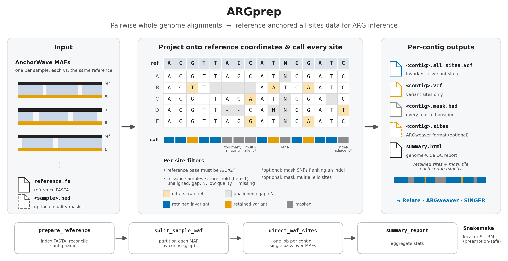

# ARGprep Pipeline 

This repository provides a Snakemake workflow for processing AnchorWave MAFs directly into per-contig site outputs. The workflow emits all-sites VCFs, variant-only VCFs, and BED masks from the alignments. Written with the aid of [Codex](https://openai.com/codex/) and [Claude](https://claude.ai/). 



If you use this please cite: 

Ross-Ibarra, J. 2026. ARGprep: A pipeline to prepare pairwise whole-genome alignments for ancestral recombination graph estimation. [doi: 10.5281/zenodo.19655050](https://doi.org/10.5281/zenodo.19655050)

If your use case is pairwise variant discovery (SNPs, large indels, inversions) rather than ARG-ready all-sites output, [wgatools](https://github.com/wjwei-handsome/wgatools) is a potential alternative. See [WGATOOLS_COMPARISON.md](WGATOOLS_COMPARISON.md) for a detailed comparison of the two approaches.

> **Which version to use:** for production runs, use the newest stable tag on
> the [GitHub Releases page](https://github.com/RILAB/argprep/releases).
> Pre-releases may include features such as the [`maf_qc` alignment-QC
> stage](docs/maf_qc.md) for testing; feedback is welcome via [GitHub
> issues](https://github.com/RILAB/argprep/issues). See
> [changelog.md](changelog.md) for a per-version breakdown of changes.

## Requirements

- Conda
- The environment defined in `argprep.yml`

The supported environment is Linux x86-64 with Python 3.11. Dependency ranges
in `argprep.yml` admit compatible updates while excluding untested major
versions. Containers are the most portable option when that environment is not
available.

## Setup

```bash
conda env create -f argprep.yml
conda activate argprep
```

To update an existing environment to the dependency ranges tested by the
current checkout:

```bash
conda env update -n argprep -f argprep.yml --prune
```

Environment creation and updates perform a dependency solve. On a shared HPC
cluster, run that solve in a compute allocation and keep the environment and
package cache on group storage rather than a quota-limited home directory.

A Docker/Singularity setup option is also available. See [container setup](container_setup.md)

## Configure

Copy the portable template and edit its input paths:

```bash
cp options.example.yaml options.yaml
```

The workflow requires `--configfile` and will fail if it is omitted.

Required keys:

- `maf_dir`: directory containing `*.maf` or `*.maf.gz`
- `reference_fasta`: reference FASTA path

**Input ploidy.** ARGprep treats each MAF as a single haplotype. For diploid individuals with haplotype-resolved assemblies, split the two haplotypes and align each to the reference separately (for example `indA_hap1.maf`, `indA_hap2.maf`), so that each haplotype is a sample. One workflow that produces compatible per-sample MAFs with AnchorWave is [anchorwave-snakemake](https://github.com/mufernando/anchorwave-snakemake); use its whole-genome `<target>.maf` output.

Optional path keys:

- `results_dir`: output directory (default: `results`)

Optional controls (defaults shown):

- `max_missing_count` - no default; see missingness thresholds below
- `max_missing_fraction` - no default; see missingness thresholds below
- `mask_indel_adjacent_snps: false` - when `true`, mask SNPs immediately flanking an indel in any sample (see [NOTES.md](NOTES.md) for exact semantics)
- `allow_multiallelic_snps: true` - retain sites with more than two alleles
- `add_ref: false` - append a synthetic `REF` sample (genotype `0`) to both VCFs
- `emit_argweaver_sites: false` - when `true`, also emit a per-contig ARGweaver `.sites` file (see [Preparing inputs for ARG inference](#preparing-inputs-for-arg-inference))
- `summary_window_bp: 100000` - window size in bp for binned per-contig plots in `summary.html` (this does not affect the per-MAF tables)
- `quality_bed_dir` / `quality_min` - no default; optional per-sample assembly-quality masking (see below)

SLURM resource overrides (for the `direct_maf_sites` rule):

- `maf_mem_mb: 48000`
- `maf_time: "24:00:00"`

SLURM profile keys (required when using `--profile profiles/slurm`):

- `slurm_account`
- `slurm_partition`

Advanced override:

- `contigs`: restrict the run to specific contigs instead of using the automatic shared-contig behavior
- `samples`: restrict the run to specific sample basenames instead of using all `*.maf` / `*.maf.gz` files in `maf_dir`

Contig and sample selection behavior:

- If `samples` is omitted, samples are auto-discovered from `*.maf` and `*.maf.gz` directly in `maf_dir` (non-recursive — nested subdirectories are ignored). Point `maf_dir` at a directory containing only your input MAFs; avoid parent directories that also hold example data or other `.maf` files.
- If both `<sample>.maf` and `<sample>.maf.gz` exist, `<sample>.maf` is used.
- If `contigs` is omitted, the workflow uses the intersection of contigs present in all selected MAFs.
- Requested contigs are matched to reference `.fai` contigs with normalization (for example `chr01` can map to `1` when unambiguous).
- Contig names are normalized before matching, so MAFs (or reference FASTAs) that differ only in casing, a leading `chr`, or an assembly/genome prefix are treated as the same contig. An assembly prefix is stripped only when it precedes a `chr` token, so `chr2`, `Zm-B73v5.chr2`, and `Zx-TIL25.chr2` all resolve to contig `2`. Accession-style names such as `NC_050096.1` (where `.1` is a version suffix, not a prefix) are left intact. All MAFs must still be aligned to the same reference genome — normalization only reconciles cosmetic naming differences, it does not make coordinates from different references comparable.
- Every explicitly configured `contigs` entry must match exactly or resolve through one unambiguous normalized alias; otherwise the workflow fails and lists the unresolved names.
- During automatic discovery, unmatched or ambiguous contigs are skipped with a warning, and the workflow fails if no contigs remain.

Example CLI override:

```bash
snakemake -j 8 --configfile options.yaml --config samples='["sampleA","sampleB"]' contigs='["chr1","chr2"]'
```

Missingness thresholds:

- `max_missing_count` is an absolute number of missing samples allowed at a retained site.
- `max_missing_fraction` is a fraction of samples allowed to be missing.
- If both are set, the workflow uses the stricter threshold.
- The fraction is converted to a count with downward truncation. For example, with 10 samples, `0.15` allows `1` missing sample.
- **If neither is set, the default is 0 - any site where even one sample is unaligned or missing is masked.** Set one of these options explicitly if you want to retain sites with partial coverage.
- A sample counts as missing at a site if it has no alignment block covering that position, carries a gap (`-`), an `N`, or any other non-ACGT character. To drop every site overlapped by a deletion in any sample, set `max_missing_count: 0` (the default) — gaps always contribute to the missing-sample count.

Repeat masking and sequence case:

- **Soft masking is ignored.** Reference and query sequences are upper-cased before calling, so lowercase repeat-masked bases are called exactly like uppercase ones. A soft-masked reference (the default distribution format for most released genomes, including B73 v5) will therefore have its repeat content genotyped, not excluded.
- Hard masking is honored, because it is indistinguishable from missing data: `N` is non-ACGT and counts toward the missing-sample thresholds above.
- If you want repeats excluded from ARG inference, ARGprep will not do it for you as a side effect of soft masking. Either supply a hard-masked reference, or pass repeat intervals through `quality_bed_dir` / `quality_min`.

Adjacent-SNP masking is documented in detail in [NOTES.md](NOTES.md).

Per-sample assembly-quality masking:

- Disabled by default. Enable it by setting both `quality_bed_dir` and `quality_min`; setting only one is an error.
- `quality_bed_dir` is a directory of per-sample BED files named `<sample>.bed` or `<sample>.bed.gz`, in each sample's **own genome coordinates** (not reference coordinates). Samples without a matching file are simply left unmasked.
- Each BED row is `chrom start end score` (whitespace-separated, 0-based half-open, `score` a 0-1 quality value). `track`/`browser`/comment lines and rows with fewer than four fields are ignored. Only intervals you want to flag need to be listed; positions not covered by any row are treated as passing.
- `chrom` must match the sample's own sequence names as they appear in that sample's MAF query rows. Both `+` and `-` strand alignments are handled (BED coordinates are always forward-strand).
- Any aligned base whose score is **below** `quality_min` is treated as missing, exactly as if it were an `N`. It therefore counts toward the `max_missing_*` thresholds and appears in that sample's `*.missing.bed`.

Reference-sample behavior:

- `add_ref: true` appends a synthetic `REF` sample (genotype `0` at every retained site) to both final VCFs.

## Run

Local (laptop, workstation, or an interactive job on a compute node):

```bash
snakemake -j 8 --configfile options.yaml
```

> **Shared clusters (e.g. UC Davis Farm):** do not run `snakemake` on a login/head
> node. Building the DAG already reads the MAF files, and a Snakemake controller
> there competes with other users and is killed when your session ends. Use the
> SLURM controller job below, or run inside an interactive `srun`/`salloc` session.

SLURM (recommended, and the standard way to run on a cluster — submit the
controller as its own job):

```bash
mkdir -p logs/slurm
sbatch profiles/slurm/run-controller.sbatch options.yaml
# watch progress:
tail -f logs/slurm/controller-<jobid>.out
```

This runs the long-lived Snakemake controller as a SLURM job on a
**non-preemptable** partition and lets it submit the per-rule jobs. The
controller must outlive every rule job, so it should never run on a preemptable
queue. The wrapper always passes `--rerun-incomplete`.
Submit from the activated `argprep` conda environment, or set
`ARGPREP_CONDA_ENV=argprep` so the wrapper can activate it for the controller
job.

The two cluster-specific values in `run-controller.sbatch` are
`--partition=high` and `--account=jrigrp` (the UCD farm defaults). Override them
for another cluster without editing the file — `sbatch` CLI flags win over the
`#SBATCH` lines:

```bash
sbatch --partition=<your-nonpreemptable> --account=<your-acct> \
       profiles/slurm/run-controller.sbatch options.yaml
```

#### Running rule jobs on a preemptable queue

Set `slurm_partition: low` (or your cluster's preemptable partition) in your
config file to send the per-rule jobs to the cheap queue. Preemption is handled
safely: `profiles/slurm/config.yaml` wires in `profiles/slurm/status-sacct.sh`,
which maps a `PREEMPTED` job to *running* rather than *failed*. A preempted job
is auto-requeued by SLURM (requires `PreemptMode=REQUEUE`, the farm `low`
default) and reruns the rule from scratch; the controller waits for it instead
of aborting the run. The same status command also makes genuinely failed jobs
(TIMEOUT, OOM, NODE_FAIL, scancel) fail cleanly instead of hanging.

If you launch the controller yourself instead of using the wrapper, do so from
inside an interactive allocation on a compute node (not a login node), on a
non-preemptable partition. It is then still vulnerable to being killed when the
allocation ends:

```bash
snakemake --profile profiles/slurm --configfile options.yaml --rerun-incomplete
```

When using the SLURM profile, set `slurm_account` and `slurm_partition` in your config file. Slurm defaults for other resources are defined in `profiles/slurm/config.yaml`. Parsing the MAFs is the most computationally expensive step in the pipeline, and direct-maf rule resources can be overridden in `options.yaml` (`maf_mem_mb`, `maf_time`). Site calling is single-threaded, so each per-contig job requests one core.

### Check alignment quality first (`maf_qc`, beta)

Before the expensive per-contig run, use the optional QC target to inspect
alignment coverage, identity, indels, structural breakpoints, assembly quality,
and cross-sample outliers:

```bash
sbatch profiles/slurm/run-controller.sbatch options.yaml maf_qc
# inspect results/maf_stats/maf_stats.html, then start the main run separately:
sbatch profiles/slurm/run-controller.sbatch options.yaml
```

The full metric definitions, strict validation rules, outputs, flagging behavior,
configuration table, and standalone commands are in the dedicated
[MAF QC guide](docs/maf_qc.md).

### Try it on the bundled example

`example_data/` ships with a small simulated dataset (`example.maf/`,
`example.reference.fa`) and a matching lightweight, site-neutral
`options.yaml`. From the repo root:

```bash
snakemake -j 4 --configfile example_data/options.yaml
```

Outputs land in `example_results/`. To regenerate the example data from scratch, see [`simulate_msprime_indels.py`](scripts/README.md#simulate_msprime_indelspy).

## Outputs

Outputs are written under `results/` by default (or under `results_dir` if provided):

- `sites/combined.<contig>.all_sites.vcf` — every retained site (invariant + variant) that passed all filters; `INFO=SC=invariant|variant` distinguishes the two
- `sites/combined.<contig>.vcf` — variant-only subset of `all_sites.vcf`
- `sites/combined.<contig>.mask.bed` — merged BED intervals for masked positions
- `sites/combined.<contig>.site_summary.tsv` — per-contig counts (see table below)
- `sites/combined.<contig>.report_stats.tsv` — compact window and per-sample counters used to build `summary.html`; the report does not rescan `all_sites.vcf`
- `sites/combined.<contig>.sites` — ARGweaver-format sites file (variant sites only; one real base per pseudo-haploid sample, `N` for missing). Emitted only when `emit_argweaver_sites: true`
- `sites/combined.<contig>.<sample>.missing.bed` — per-sample missing regions used by per-MAF summary stats; 4-column BED (`chrom`, `start`, `end`, `sample`)
- `sites/combined.<contig>.sample.mask.bed` — concatenation of all per-sample missing BEDs for the contig, in configured sample order
- `summary.html` — genome-wide overview plus per-MAF tables and per-contig per-MAF breakdowns. Each contig gets two binned plots: invariant and missing on a fixed 0–100% axis, and variable sites on their own auto-scaled axis (variable sites are usually a fraction of a percent and are unreadable at 0–100%). The variable axis bound is computed once across all contigs, so contigs remain directly comparable to each other.
- `maf_by_contig/<sample>/<contig>.maf.gz` — intermediate per-contig MAF chunks produced by the `split_sample_maf` stage (each per-sample MAF is partitioned by reference contig so site calling reads only the relevant slice, and chunks are gzip-compressed to avoid duplicating the alignment corpus uncompressed); these are regenerable intermediates, not final outputs

Both VCFs share the same header and use a single haploid `GT` per sample (`0` for the REF allele, `1`/`2`/... for ALTs in `ALT` order, `.` for missing). `INFO` carries `NS` (non-missing samples), `MS` (missing samples), and `SC` (`invariant` or `variant`). All retained sites are emitted with `FILTER=PASS`; filtered-out positions appear in the BED mask, not the VCFs.

`all_sites.vcf` remains a required scientific output containing invariant as well as variant retained sites. Report statistics are accumulated during the same calling pass and written separately so generating `summary.html` does not reread the large VCF.

Optional `.sites` files are generated only when enabled. Two caveats apply when toggling `emit_argweaver_sites` inside a results directory you have already run:

- **Enabling it:** run the default target (plain `snakemake --configfile options.yaml`). If you ask only for `results/summary.html`, nothing in that part of the DAG forces the site-calling rule to re-run, so no `.sites` file is written. A fresh results directory produces `.sites` either way.
- **Disabling it:** stale `.sites` files from a previous run are left in place rather than deleted. Start from a clean results directory if that distinction matters.

The `site_summary.tsv` contains one metric per row with columns `metric` and `value`:

| metric | description |
|---|---|
| `contig` | contig name |
| `contig_length` | contig length in bp |
| `samples` | number of samples |
| `allowed_missing` | effective missing-sample threshold used |
| `all_sites` | retained sites (invariant + variant) |
| `variants` | retained variant sites |
| `invariant` | retained invariant sites |
| `masked_total` | total masked positions |
| `masked_intervals` | number of merged BED intervals in the mask |
| `masked_missingness` | positions masked due to too many missing samples |
| `masked_indel_adjacent` | SNPs masked because they immediately flank an indel |
| `masked_multiallelic` | positions masked due to more than two alleles |
| `masked_no_alignment` | positions masked because at least one sample had no alignment |
| `masked_ref_non_acgt` | reference positions with non-ACGT bases (always masked) |

The pipeline still validates that retained sites plus the mask span each contig exactly, but that check is now internal and is no longer written as a separate `coverage.txt` file.

### Preparing inputs for ARG inference

The variant-only VCF (`sites/combined.<contig>.vcf`) is a standard VCF and can be fed to downstream ARG-inference tools directly or after a light conversion. ARGprep does not need to produce a genetic/recombination map — that is an independent biological input the inference tool takes separately (a scalar rate for ARGweaver, a `--map` file for Relate).

**Relate.** Convert the variant VCF to Relate's haps/sample format with the `RelateFileFormats` helper that ships with Relate:

```bash
RelateFileFormats \
  --mode ConvertFromVcf \
  --haps combined.<contig>.haps \
  --sample combined.<contig>.sample \
  -i sites/combined.<contig>     # reads sites/combined.<contig>.vcf
```

You then supply Relate itself with a genetic map (`--map`) and mutation/recombination rates at run time; a flat constant-rate map is fine if you have no measured map. See the [Relate documentation](https://myersgroup.github.io/relate/) for the full pipeline (`PrepareInputFiles`, ancestral-allele polarization, and mask handling — the per-contig `mask.bed` can seed the accessibility mask).

> **Note:** ARGprep emits a single-allele haploid `GT` per sample. Relate is designed around phased haplotype data, so verify the converted `.haps` treats each sample as one haplotype as you expect before running a large analysis.

**ARGweaver.** Set `emit_argweaver_sites: true` to have the pipeline write a native `.sites` file per contig directly — no conversion step needed. Each `sites/combined.<contig>.sites` is:

```
NAMES   <sample1>  <sample2>  ...
REGION  <contig>   1  <contig_length>
<pos>   <one real base per sample>      # variant sites only; missing calls are N
```

Because ARGprep is pseudo-haploid, each sample contributes exactly one character per site (no phasing needed). Only variant sites are listed — the set matches `sites/combined.<contig>.vcf`. When `add_ref: true`, the synthetic REF haplotype is appended as the final column (always the reference base). Supply ARGweaver's recombination rate on its command line (`arg-sample -r ...`); ARGprep does not emit a recombination map.

**SINGER.** No conversion needed — SINGER reads a VCF directly (`singer_master -vcf sites/combined.<contig> ...`, without the `.vcf` suffix). Supply the mutation/recombination rates on SINGER's command line.

## Testing

```bash
pytest -q
```

## Helper scripts

Standalone utilities that are not part of the Snakemake workflow are documented in [scripts/README.md](scripts/README.md): `popstats.py`, `window_to_fasta.py`, `maf_to_fasta.py` and `simulate_msprime_indels.py`.
